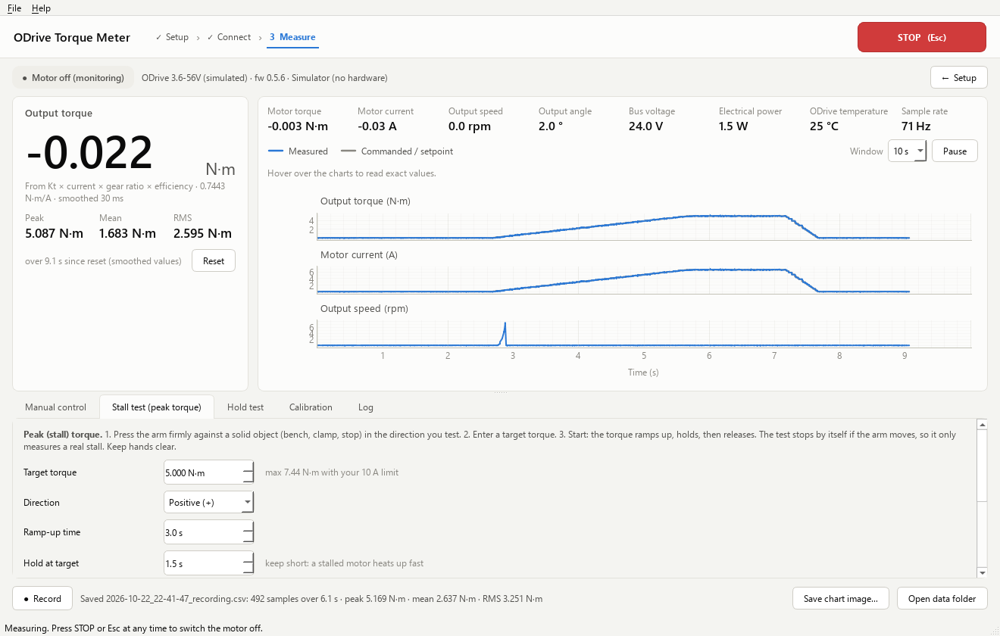
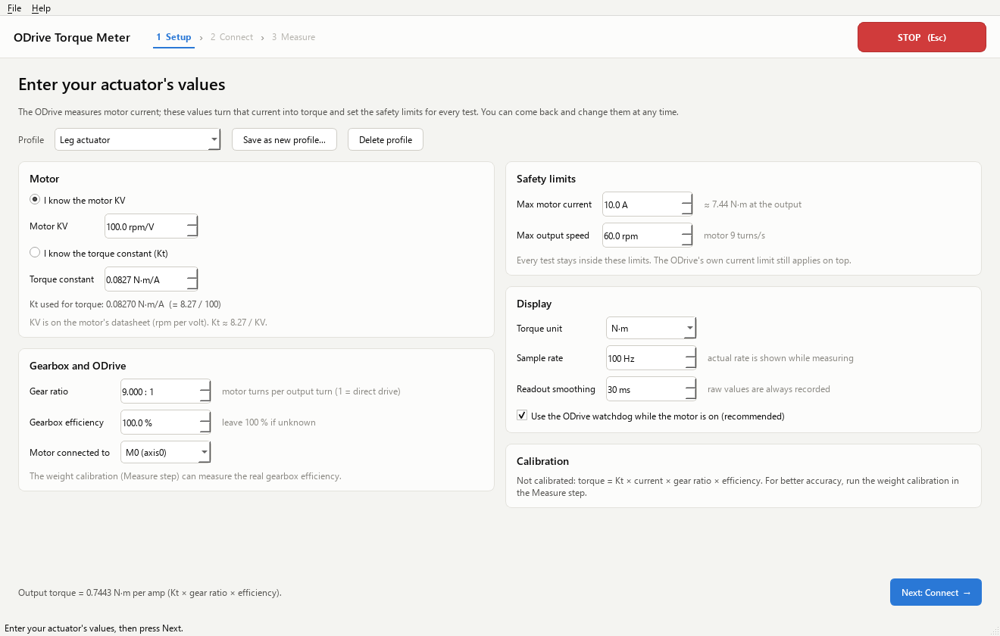
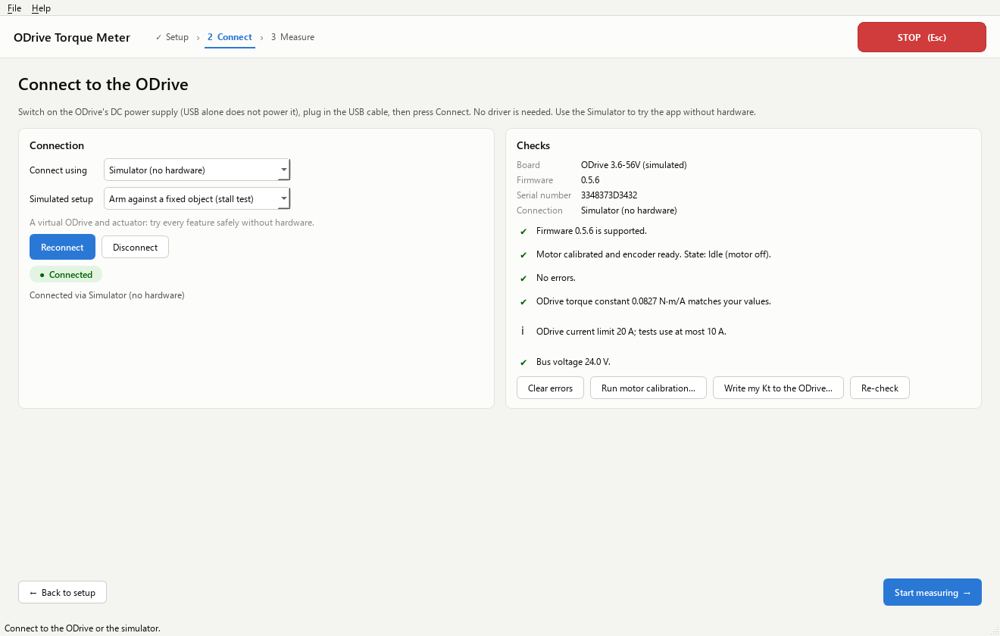
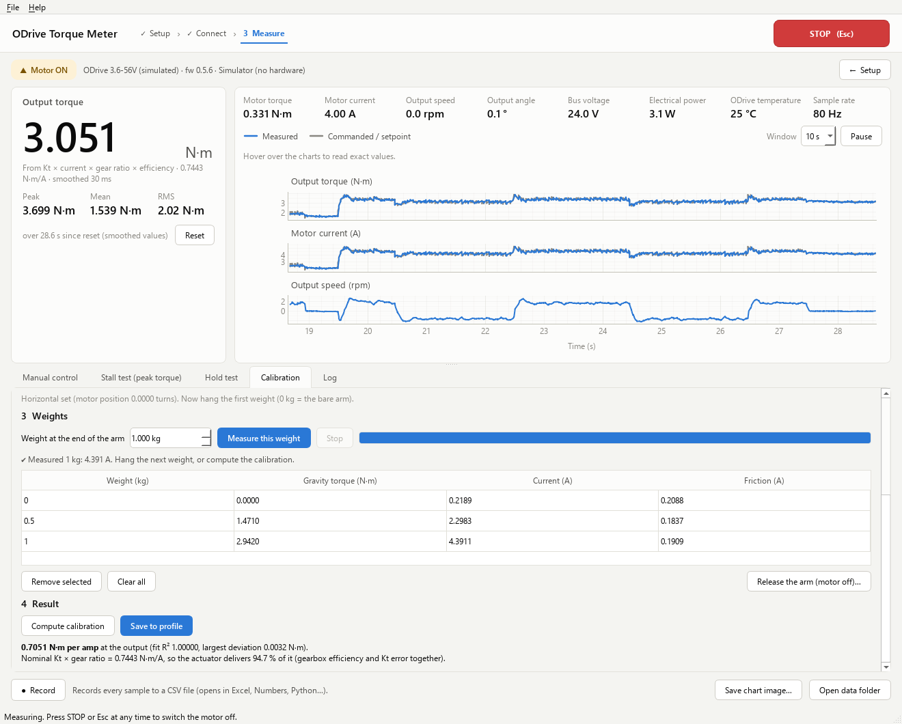

# ODrive Torque Meter

Measure the torque your **ODrive V3.6** actuator produces: live, while it works, and with automated
**stall (peak torque)** and **holding torque** tests. Runs on **macOS** (Apple Silicon and Intel) and
**Windows**. Includes a simulator, so you can try everything without hardware.



## What it does

- **Live torque**: big output-torque readout with peak, mean and RMS, plus motor current, speed,
  angle, bus voltage, power and temperature, with live charts.
- **Stall test (peak torque)**: press the arm against a fixed object; the app ramps the torque up to
  your target, holds it briefly and releases. It stops by itself if the arm moves.
- **Hold test (holding torque)**: the motor holds its position while you apply a load.
- **Operational torque**: watch and record torque while the actuator runs (motor off, or in torque,
  speed or position control).
- **Weight calibration**: hang known weights on a lever arm to measure the real torque per amp
  (corrects gearbox losses and an inexact motor constant).
- **Recording**: every sample to CSV (opens in Excel/Numbers), plus a results folder per test.
- **Safety**: STOP button (Esc / Space), limits you set first, ODrive watchdog, motor off on exit.

## How the torque is measured

The ODrive has no torque sensor. It measures the motor's torque-producing current (*Iq*), and torque
follows from it:

```
motor torque  = Kt × Iq            with Kt ≈ 8.27 / KV   [N·m per amp]
output torque = motor torque × gear ratio × gearbox efficiency
```

After a weight calibration the app uses the measured value instead:
`output torque = K_cal × Iq`.

How accurate is it?
- Without calibration, expect roughly **±10–20 %** (KV from a datasheet is approximate, and gearbox
  losses are unknown).
- With the weight calibration, a few percent in steady conditions.
- At very high currents motors saturate magnetically, so the real peak torque can be somewhat lower
  than the current-based number. Only an external load cell would show that.
- While the actuator accelerates, part of the torque goes into accelerating the motor and arm.

## Before you start

- ODrive **V3.6** with firmware **0.5.x** (0.5.6 is the latest and recommended).
- The ODrive is already **set up for your motor** (motor and encoder calibrated; it works in
  odrivetool). The app can re-run the motor calibration, but it doesn't configure a new motor.
- The ODrive's **DC power supply is on**. USB alone does not power the ODrive.
- A **USB data cable** from the ODrive to the computer (some cables only charge).
- The actuator is **clamped down** so it can't move around.

## Install and start

### macOS

1. **Install Python** 3.12 or 3.13: download the macOS installer from
   [python.org/downloads](https://www.python.org/downloads/) and run it.
2. **Get the app**: on this GitHub page click **Code → Download ZIP** and unzip it (or
   `git clone` the repository).
3. **Start it**: open **Terminal**, type `bash ` (with a space), drag the file `start_mac.command`
   from the app folder into the Terminal window, and press Enter.

The first start installs everything into a private folder (`.venv` inside the app folder). This
needs internet and takes a few minutes. After that, the same command starts the app straight away.

> Double-clicking `start_mac.command` also works if the file is executable. If macOS says it
> "cannot be opened because it is from an unidentified developer", use the Terminal method above.

### Windows

1. **Install Python** 3.12 or 3.13 from [python.org/downloads](https://www.python.org/downloads/).
   During setup, tick **"Add python.exe to PATH"**.
2. **Get the app**: **Code → Download ZIP**, then unzip it.
3. **Double-click `start_windows.bat`**. The first start installs everything (a few minutes).

No USB driver is needed on either system: the ODrive's built-in USB serial port works out of the
box.

### Try it without hardware

On the Connect page choose **Simulator (no hardware)**. "Arm against a fixed object" is set up for
the stall test, and "Arm with a hanging weight" for the calibration. You can also start straight
into it with `python -m torque_meter --sim`.

## Using the app

The app guides you through three steps: **1 Setup → 2 Connect → 3 Measure**.

### 1 · Setup: enter your actuator's values



| Field | What to enter |
|---|---|
| Motor KV *or* torque constant | KV from the motor's datasheet (rpm per volt), or Kt in N·m/A if you know it. |
| Gear ratio | Motor turns per output turn, e.g. `9` for a 9:1 planetary. `1` for direct drive. |
| Gearbox efficiency | Leave 100 % if unknown; the weight calibration measures the real value. |
| Motor connected to | M0 or M1 on the ODrive. |
| Max motor current | The highest current any test may use (the ODrive's own limit still applies). |
| Max output speed | Speed limit at the output for manual control and tests. |
| Torque unit | N·m, kgf·cm or lbf·in. Files always store N·m. |

Values are checked as you type. **Next** unlocks when everything is valid. Save different
actuators as profiles.

### 2 · Connect



Choose **Auto** (recommended) and press **Connect**. Auto tries the ODrive's USB serial port first,
then the official ODrive Python library if it's installed. The checklist then shows:

- firmware version
- whether the motor and encoder are calibrated
- any errors, in plain English
- whether the ODrive's torque constant matches your values
- the ODrive's current limit and bus voltage

Buttons: **Clear errors**, **Run motor calibration** (the output must be free to move) and
**Write my Kt to the ODrive** (optional: the app already corrects for a mismatch).

### 3 · Measure

- **Live readouts and charts.** Hover over the charts to read exact values. **Pause** freezes them,
  and **Window** sets the time span. **Peak / Mean / RMS** run since the last **Reset**.
- **Manual control.** With the motor off you are only monitoring. **Switch motor on** in Torque,
  Speed or Position (hold) mode, then use the slider or the number field. Operational torque is
  whatever the dashboard shows while the actuator does its job; record it with **Record**.
- **Stall test (peak torque).**
  1. Press the arm firmly against something solid (bench, clamp, end stop) in the direction you test.
  2. Enter the target torque (the maximum allowed by your current limit is shown) and the times.
     Keep the hold short: a stalled motor heats up quickly.
  3. Press **Start stall test** and keep your hands clear.

  You get the peak torque, the current at the peak, the average while holding, how far the arm
  moved and the temperature rise. If the arm moves more than the allowed angle, the test stops: it
  wasn't a real stall.
- **Hold test.** The motor holds its position while you push the arm, hang a weight or run your rig.
  You get the peak and the steady holding torque. The torque limit decides when the actuator gives
  way.
- **Calibration.** You need a rigid arm of known length on the output and two or three known weights
  (e.g. 0, 0.5 and 1 kg).
  1. Enter the arm length.
  2. Make the arm level (by hand with the motor off, or press **Hold the arm** and jog it). Check
     with a spirit level, then press **Arm is level: set horizontal**.
  3. For each weight, enter it and press **Measure this weight**. The arm sweeps slowly ±10°
     around horizontal; averaging the up and down movement cancels friction.
  4. Press **Compute calibration**, then **Save to profile**. From then on, torque readings use the
     calibrated value.
  5. Before **Release the arm**, support the arm or remove the weight: it drops when the motor
     switches off.



### Where your data goes

Recordings and test results go to **Documents/ODrive Torque Meter** (change it under
**File → Change data folder**). Each test creates a folder with `summary.json`, `data.csv` and a
chart image. CSV files start with `#` lines listing the settings used (KV, gear ratio,
calibration, ODrive serial number…).

## Safety

- Clamp the actuator down and keep hands, cables and people out of the arm's path.
- **STOP** (top right), **Esc** or **Space** switch the motor off immediately.
- The motor never switches on by itself: the Switch motor on and Start buttons do it, within the
  limits from Setup.
- While the motor is on, the ODrive's **watchdog** is active. If the app freezes or the USB cable
  is pulled, the ODrive switches the motor off within about a second.
- In **torque mode with the output free**, the actuator accelerates up to the speed limit.
- **Stalled motors heat up fast.** Keep stall holds to a few seconds and watch the temperature.
- Settings the app changes on the ODrive (limits, control mode, watchdog) are put back when you
  disconnect. Nothing is saved permanently to the ODrive.

## Troubleshooting

| Problem | What to do |
|---|---|
| "No ODrive serial port found" | Switch the ODrive's DC power on (USB doesn't power it). Try another cable or USB port. Run `python -m torque_meter ports` (inside `.venv`) to list ports. |
| "didn't answer like an ODrive" | The ODrive's USB port may be set to another protocol. Use the **Official ODrive library** connection, or in odrivetool run `odrv0.config.usb_cdc_protocol = 3` then `odrv0.save_configuration()`. |
| Official library: "could not claim interface" | Only one program can use that connection. Close odrivetool (the USB serial connection doesn't have this limit). |
| Motor won't switch on | Look at the Connect checklist: clear errors, and make sure the motor is calibrated and the encoder is ready. |
| Torque mode gives less torque than set at standstill | The ODrive caps torque in torque mode to `vel_limit × vel_gain`. Raise the speed limit, or use the Stall test, which handles this automatically. |
| `WATCHDOG_TIMER_EXPIRED` | The app stopped talking to the ODrive (cable, sleep, freeze). Clear errors and continue. |
| Firmware 0.5.2 / 0.5.3 | These have ASCII-protocol bugs. Use the Official library connection or update to 0.5.6. |
| Anything else | **Help → Save debug report…** and send the file to whoever helps you. It contains versions, ODrive settings and recent log messages. |

## Command-line tools

These never move the motor:

```
python -m torque_meter ports                         # list serial ports, ODrives marked
python -m torque_meter info                          # board, firmware, state, errors, configuration
python -m torque_meter monitor --kv 100 --gear 9     # print live torque (Ctrl+C to stop)
python -m torque_meter monitor --csv run.csv --seconds 30
```

Run them with the app's Python: `.venv/bin/python` on macOS/Linux, `.venv\Scripts\python` on
Windows. Add `--connection simulator` to try them without hardware.

## For developers

```
torque_meter/
  odrive_api.py        firmware 0.5.x property paths, enums, error codes with explanations
  backends/            serial_backend (ASCII over USB), native_backend (official odrive library),
                       simulator (virtual ODrive + actuator), sim_serial (fake serial port)
  device.py            safe high-level axis control (arming, limits, watchdog, restore)
  acquisition.py       background worker: polling, torque, procedures, commands
  procedures.py        stall test, hold test, calibration sweep
  calibration.py       known-weight calibration math
  torque.py            Kt, gear ratio, units, filters, statistics
  recorder.py, settings.py, diagnostics.py, cli.py
  ui/                  PySide6 interface (setup, connect and measure pages, live charts)
tests/                 unit, protocol, end-to-end and GUI tests (all against the simulator)
```

```
python -m venv .venv && .venv/bin/pip install -r requirements.txt pytest
.venv/bin/python -m pytest          # runs headless; set QT_QPA_PLATFORM=offscreen on CI
.venv/bin/python -m torque_meter --sim
```

GitHub Actions runs the tests on macOS, Windows and Ubuntu (Python 3.10 and 3.13), and runs the
launch scripts on a fresh macOS and Windows machine.

Built on the ODrive 0.5.6 documentation: [getting started](https://docs.odriverobotics.com/v/0.5.6/getting-started.html),
[ASCII protocol](https://docs.odriverobotics.com/v/0.5.6/ascii-protocol.html),
[API reference](https://docs.odriverobotics.com/v/0.5.6/fibre_types/com_odriverobotics_ODrive.html).

## License

MIT. See [LICENSE](LICENSE). ODrive is a trademark of ODrive Robotics; this project isn't affiliated
with them.
